<div align="center">
  
</div>

<br />

## 🕹️ Player Info

| STAT | VALUE |
| :-- | :-- |
| **Player** | BOINRED |
| **Class** | Game Server Programmer → Founder → CTO |
| **EXP** | 2008년부터 적립 중 |
| **Current Quest** | 🔭 다양한 프로젝트를 개발하고 있습니다 |
| **Passive Skill** | 🌱 새로운 기술을 배우고 성장하는 것을 좋아합니다 |

## ⚔️ Active Quests

> 현재 진행 중인 프로젝트

| 프로젝트 | 설명 | 스택 |
| :--- | :--- | :--- |
| [**FastPort**](https://github.com/boinred/FastPort) | IOCP를 이용한 C++ 네트워크 프로젝트<br>• **Scatter-Gather 송신** — 여러 버퍼를 `WSABUF`로 묶어 한 번에 송신<br>• **Zero-copy 수신 + 객체 풀** — 자주 쓰는 패킷·세션 경로의 복사와 할당 최소화 | `C++20` · `IOCP` · `Protobuf` |
| [**FastPortSharp**](https://github.com/boinred/FastPortSharp) | IOCP를 이용한 C# 네트워크 프로젝트 (.NET 10)<br>• **ArrayPool 원형 버퍼** — 버퍼 재사용으로 트래픽이 계속 몰려도 GC 부담 최소화<br>• **Bounded `Channel<T>`** — 송수신 파이프라인에 적용, `BufferBlock<T>` 대비 4배 빠르고 메모리 69% 절감 | `C#` · `.NET 10` · `Protobuf` |
| [**Noxtend**](https://github.com/boinred/Noxtend) | AI로 3D 에셋을 만드는 프로젝트<br>• LLM의 장면·파츠 분석과 이미지 생성 모델의 에셋 레퍼런스 생성<br>• 사람이 파츠를 검수·수정한 뒤 생성으로 연결<br>• 프롬프트 버전, 골든 샘플, 호출 기록을 제품 안에서 관리 | `React` · `TypeScript` · `ASP.NET Core` · `.NET 10` · `SQL Server` · `Redis Streams` |

## 📜 Quest Log

```diff
@@ 2024 ~ 2026 · 더블미 @@
+ CTO                     노예는 아니지만 멋진 슬레이브

@@ 2018 ~ 2024 · 게임그레스 @@
+ CEO & TD                인생 첫 창업!

@@ 2011 ~ 2017 · 엔씨소프트 @@
+ Game Server Programmer  리니지M 게임 서버 개발
+ Game Server Programmer  리니지1 게임 서버 개발

@@ 2008 ~ 2010 · 나우콤 @@
+ Game Server Programmer  포트파이어 게임 서버 개발
```

## 🎒 Inventory



## 📊 Server Monitor

<p align="center">
  
  
</p>

## 🤝 Party Invite

<p align="center">
  <a href="https://github.com/boinred">
    
  </a>
</p>

<p align="center"><sub><code>Connection closed by remote host. GG! 🎮</code></sub></p>
